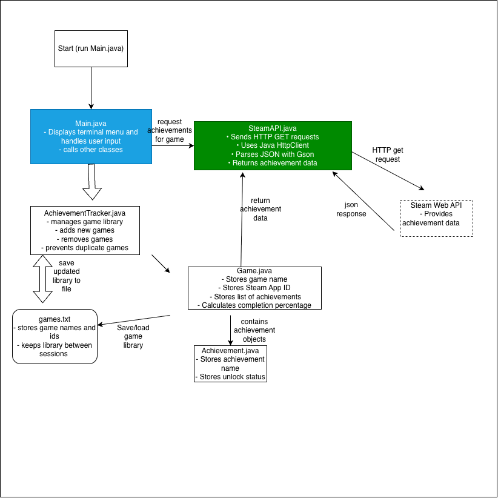

# Achievement Hub

A Java-based terminal application designed to track video game achievements and completion progress across multiple Steam games.

## The Problem

As someone who likes playing video games, keeping track of different games' progress is an inconvenient task. 
It would be much easier if achievement and progress tracking were all on one platform.

## How It Works

AchievementHub will provide a terminal-based interface where users can manage their Steam game library and retrieve achievement information using the Steam Web API.
- Add and remove Steam games using their names and App IDs.
- Save and load a library of multiple games.
- Retrieve achievement data from the Steam Web API.
- Display locked and unlocked achievements.
- Calculate achievement completion percentages.
- Manually refresh achievement information.

## Tech Stack

- **Language:** Java
- **Libraries:** Google Gson for parsing JSON responses
- **Built-In Java Tools:** HttpClient, Scanner, and File I/O
- **External API:** Steam Web API
  
## Roadmap

- Display Steam and non-Steam games together in the same library.
- Manually add games from Epic Games and other platforms.
- Manually enter and update unlocked and total achievement counts.

## Author

Krishna Veer, [GitHub](https://github.com/kveer124).

