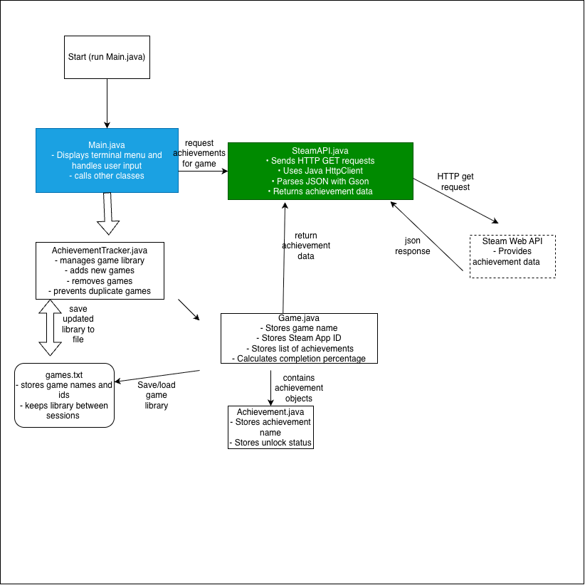

# AchievementHub

A Java-based terminal application designed to track video game achievements and completion progress across multiple Steam games.

## The Problem

As someone who likes playing video games, keeping track of different games' progress is an inconvenient task. It would be much easier if achievement and progress tracking were all on one platform.

## How It Works

AchievementHub provides a terminal-based interface where users can manage their Steam game library and retrieve achievement information using the Steam Web API.

- Add and remove Steam games using their names and App IDs.
- Automatically save and load the game library between sessions.
- Retrieve achievements automatically when the application starts or a new game is added.
- Display locked and unlocked achievements.
- Calculate achievement completion percentages.
- Manually refresh achievement information for all games.
- Sort games by completion percentage in ascending or descending order.
- Preserve previously retrieved achievements when an API request fails and returns null.

Steam API credentials are entered using hidden terminal input and are not saved to a file. Game names and App IDs are stored locally in `games.txt`, while achievement data is stored in memory during each session.



## Tech Stack

- **Language:** Java
- **Libraries:** Google Gson 2.15.0 for parsing JSON responses
- **Built-in Java Tools:** HttpClient, Console, IO, Comparator, ArrayList, and File I/O
- **External API:** Steam Web API
- **Development Tools:** Git, GitHub, and Visual Studio Code
- **Data Storage:** Local text file (`games.txt`)

## Setup

### Prerequisites

- Java Development Kit (JDK 27)
- Git
- Steam account
- Steam Web API key
- SteamID64
- Internet connection

Gson is already included in the repository, so no additional library installation is required.

### 1. Clone the repository

```bash
git clone https://github.com/kveer124/AchievementHub.git
cd AchievementHub
```

### 2. Verify your Java installation

```bash
java -version
javac -version
```

### 3. Obtain your Steam credentials

- Obtain your Steam API key from [Steam Web API Key](https://steamcommunity.com/dev/apikey).
- Find your SteamID64 through your [Steam Account Details](https://store.steampowered.com/account/).
- Ensure your Steam profile and game details are accessible to the API.

### 4. Compile the application

```bash
javac -cp "lib/*" src/*.java
```

### 5. Run the application

**macOS/Linux:**

```bash
java -cp "src:lib/*" Main
```

**Windows:**

```powershell
java -cp "src;lib/*" Main
```

Run the application in a terminal rather than an IDE debug console to support hidden credential input.

Enter your Steam API key and SteamID64 when prompted. The characters will not appear while typing for privacy.

## Usage

After entering your Steam credentials, the application displays the following menu:

```text
ACHIEVEMENTHUB
1. View Game Library
2. Add Game
3. View Game Achievements
4. Refresh Achievements
5. Remove Game
6. Exit

Enter your choice (1-6):
```

### Example: Adding a Game

```text
Enter your choice (1-6):
2

Enter Game Name:
Dark Souls III

Enter the Game's App Id:
374320

Game successfully added to your library
```

### Example: Viewing and Sorting the Game Library

```text
Enter your choice (1-6):
1

SORT GAME LIBRARY

1. Default Order
2. Highest Completion First
3. Lowest Completion First

Enter your choice: 2

GAME LIBRARY

Dark Souls III
App ID: 374320
Completion: 81.40%

Elden Ring
App ID: 1245620
Completion: 45.00%
```

Games whose achievement information has not been retrieved display `Completion: Not Loaded`.

## Roadmap

### Version 1.0 — MVP

- [x] Add and save multiple Steam games using App IDs.
- [x] Retrieve achievements through the Steam API.
- [x] Display locked and unlocked achievements.
- [x] Calculate completion percentages.
- [x] Save and load the game library between sessions.
- [x] Add and remove games through a terminal interface.
- [x] Manually refresh achievement information.
- [x] Automatically retrieve achievements at startup.

### Version 2.0 and Beyond

- [x] Sort games by completion percentage in ascending or descending order.
- [ ] Display Steam and non-Steam games together in the same library.
- [ ] Manually add games from Epic Games and other platforms.
- [ ] Manually enter and update unlocked and total achievement counts.

## Demo

## Author

Krishna Veer, [GitHub](https://github.com/kveer124).
